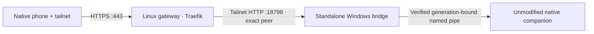

# OpenMausBot tailnet bridge (experimental)

A separate, Windows-only companion compatibility proxy for a trusted, single-owner tailnet. It offers a DNS HTTPS route when the phone's native HTTP setup cannot use your private network names. **It never patches the native app, discovers API control tokens, or bypasses native authentication.**



**The gateway terminates TLS and sees plaintext.** This is not phone-to-Windows E2E encryption. All participating hosts must stay awake; the Windows app and phone access must remain active. Pinned E2E descriptors are refused, never downgraded.

## Start here

1. Read [security and privacy](docs/PRIVACY-SECURITY.md) and [design](docs/DESIGN.md).
2. Build and install with [the step-by-step guide](docs/INSTALL.md). All domains, IPs and usernames in examples are fictional; replace them privately.
3. Use [owner-UI pairing](docs/PAIRING.md), then perform the actual-phone acceptance checks.
4. Keep [update/uninstall instructions](docs/MAINTENANCE.md) available.
5. For desktop clients, read [computer-to-computer pairing](docs/COMPUTER-PAIRING.md): it needs a separate host-issued server code and is **not implemented by the phone launcher**.

The Go proxy retains native bearer authentication, rejects browser Origins, validates the gateway peer/Host/HTTPS marker, strips private authority headers, and verifies Windows pipe server/parent identity before sending application bytes. Only successful routing metadata changes; non-routing credentials and keys remain native-owned. There is no TCP upstream fallback.

```sh
go test -race -timeout 120s ./...
mkdir -p dist
GOOS=windows GOARCH=amd64 go build -trimpath -ldflags='-H=windowsgui' -o dist/openmausbot-tailnet-bridge.exe .
PYTHONDONTWRITEBYTECODE=1 python3 -m unittest discover -s tools -v
```

Go is pinned through `go.mod` (toolchain Go 1.27.4). See [validation](docs/VALIDATION.md) for what is and is not tested. Linux/macOS can run tests and cross-build; the production pipe dialer only works on Windows.

## Package layout

- Root: Go proxy and tests; public module `github.com/jakkzz/openmausbot-tailnet-bridge`.
- `examples/`: sample Windows config and isolated Linux Traefik configuration.
- `scripts/`: Windows private staging, limited task, narrow firewall, update/rollback and removal.
- `tools/`: Python invite re-addressing, one-line/terminal QR display, and **source-only** macOS Swift QR utilities.
- `docs/`: design, installation, privacy, pairing and maintenance.
- `docs/ci-workflow.example.yml`: inactive CI template for Ubuntu/Windows tests, cross-build and macOS QR checks. See [activation instructions](docs/VALIDATION.md#activating-ci).

No live configuration, native screenshots, pairing material, DNS credentials, binaries or deployment state is included. Optional Cua automation and machine-specific launchers are intentionally omitted; use the native owner UI manually. A new portable `scripts/pair-phone.command` can guide private invite creation, wait for human phone readiness, and display the fresh link plus a QR directly in the terminal without replacing any existing launcher. Nothing in this package installs or updates Cua or changes shell/security profiles.

**Limitations:** custom protocol compatibility, not vendor-supported. Re-review after native app updates. Protected native-app access and real-phone end-to-end behavior are **not proven by unit tests**.

**License:** [MIT](LICENSE), covering this standalone bridge and its original tooling/documentation. OpenMausBot and third-party dependencies retain their own licenses.
